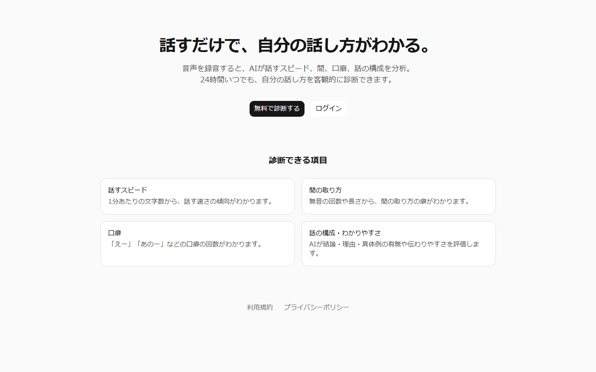
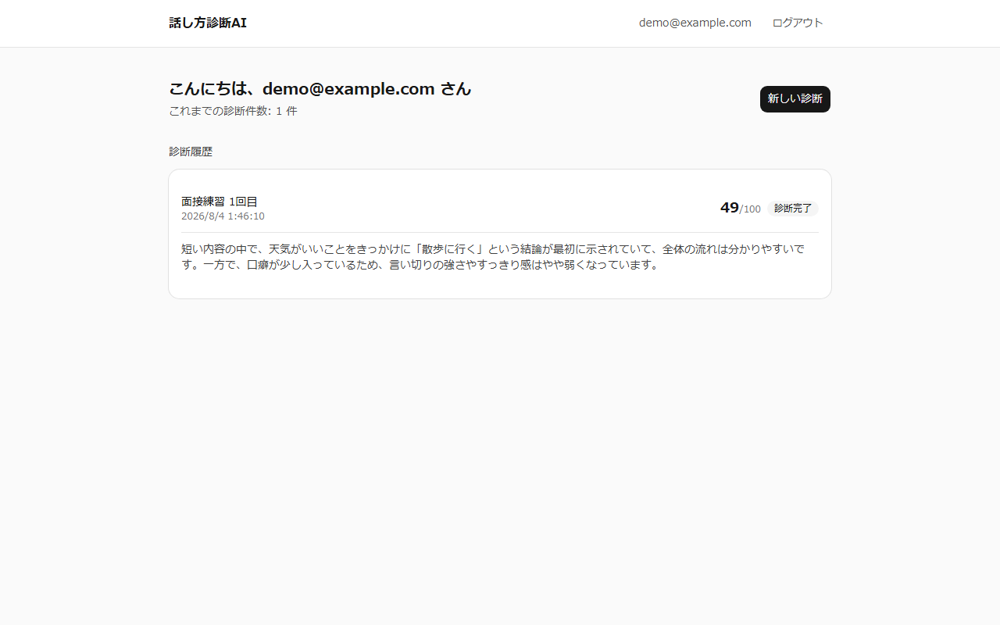
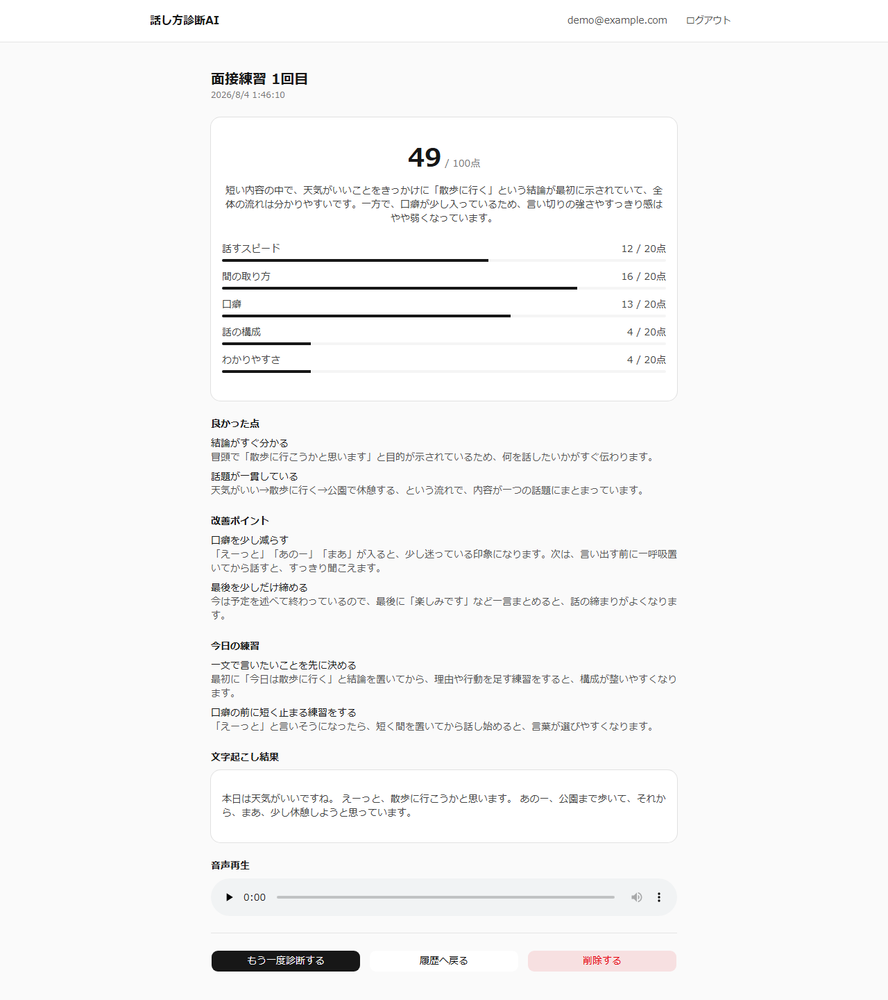

# 話し方診断AI

音声を録音・アップロードするだけで、AIが話すスピード・間の取り方・口癖・話の構成・わかりやすさを分析し、スコアとフィードバックを返すWebアプリです。

**Live Demo:** https://ai-speech-app-phi.vercel.app

## スクリーンショット

### トップページ


### ダッシュボード（診断履歴）


### 診断結果詳細
スコア・良かった点・改善ポイント・練習方法・文字起こし・音声再生を1画面で確認できます。



## できること

- ブラウザでの音声録音、または音声ファイル（mp3 / wav / m4a / webm）のアップロード
- AI（Whisper）による自動文字起こし
- 話すスピード・間（無音）の回数と長さ・口癖の自動検出
- AIによる話の構成・わかりやすさの評価、総合スコア（100点満点）
- 良かった点・改善ポイント・練習方法の自動生成
- 診断履歴の一覧・詳細表示、削除
- メールアドレス／パスワードによるアカウント登録・ログイン、パスワード再設定

## 技術スタック

| 分類 | 使用技術 |
|---|---|
| フレームワーク | [Next.js 16](https://nextjs.org/)（App Router） |
| 言語 | TypeScript |
| UI | Tailwind CSS, [shadcn/ui](https://ui.shadcn.com/)（Base UI） |
| フォーム / バリデーション | React Hook Form, Zod |
| 認証・データベース・ストレージ | [Supabase](https://supabase.com/)（Auth / Postgres / Storage, Row Level Security） |
| AI（文字起こし・診断） | OpenAI（Whisper, GPT-5.4 mini）経由 [Vercel AI SDK](https://ai-sdk.dev/) |
| メール配信 | [Resend](https://resend.com/)（SMTP） |
| デプロイ | [Vercel](https://vercel.com/) |

## アーキテクチャのポイント

- **数値分析とAI診断の分離**: 話すスピード・間・口癖のスコアは数値から機械的に算出し、話の構成・わかりやすさのスコアと講評はAIが生成。しきい値・配点は`src/config`に切り出し、AIプロンプトは`src/lib/ai/prompts`に分離して、評価基準を変更しやすい構成にしている。
- **Row Level Security**: 全テーブル・Storageバケットにポリシーを設定し、ユーザーは自分の診断データにのみアクセス可能。
- **失敗を分離したパイプライン**: 音声保存 → 文字起こし → 数値分析 → AI診断の各ステップを個別にtry/catchし、後段が失敗しても前段の結果（音声・文字起こし等）は失われない設計。

## セットアップ

```bash
npm install
cp .env.example .env.local  # 各種キーを設定
node scripts/run-migrations.mjs  # DBマイグレーション適用
npm run dev
```

必要な環境変数は `.env.example` を参照してください（Supabase・OpenAIのAPIキーが必要です）。
